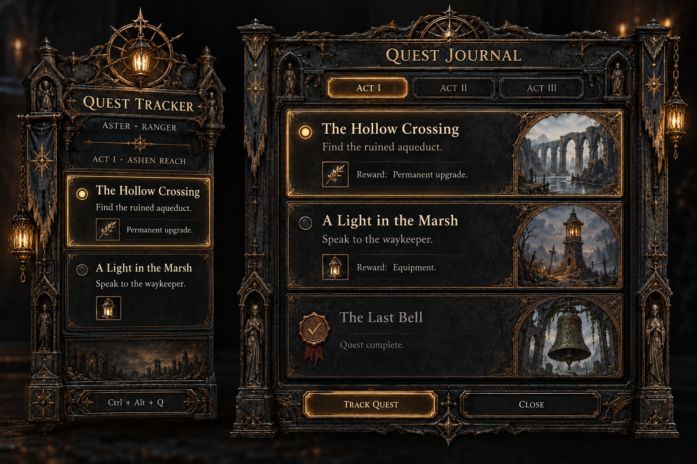

# ExilePact2 — Approved UI Design System

**Status: approved visual direction; Quest Tracker UI adoption, 2026-10-31.**
Quest Tracker is the primary example in a shared family with Waystone Roller
and Crafting Helper. Quest Tracker uses its selected theme consistently across
play, edit, Next up, All and Settings; Exile uses the carved stone/gold folio.
Quest Tracker implements this direction as its default **Exile** theme, with
the original **Claude** theme selectable in both Settings surfaces. This is not
a product rename. Waystone/Crafting retain their existing appearance.

The apps remain separate tools. Existing behavior, native window limits,
backend-owned state and export contracts remain authoritative:
[Quest Tracker design brief](quest-tracker/ui-design-brief.md),
[Waystone Roller UI design](waystone-roller/ui-design.md) and
[Crafting Helper UI design](crafting-helper/ui-design.md).
All numerical values below are proposed production metrics, not measurements
or color samples from AI artwork or screenshot crops.
Reference analysis distinguishes observed details from proposed decisions.
The current adoption is a one-to-one UI conversion: [preservation map](quest-tracker/design/approved-ui-preservation.md)
and [rendered review](quest-tracker/design/review-approved-ui.md). It adds no
native-HUD operation, game setup or automatic positioning; placement illustrations
below remain design studies. The concept image remains documentation artwork.

## Reference analysis

Evidence: ten owner-supplied screenshots received 2026-10-31, identified below by timestamp suffix. Measurements of pixels in these differently cropped images would not establish production spacing tokens, exact typefaces or original hex colors. Observed means visible in a still; proposed means our design decision. Static images establish neither hover behavior nor keyboard interaction, timing or animation. No attached text is treated as an instruction.

| Reference | Observed design principle | Retain and transform |
|---|---|---|
| 120818 Options/Input | Sculptural crest over a luminous title plate; weathered stone surround, inset gold trim, deep black field; tab shoulders and recessed controls; aligned label/control columns | Preserve the architectural hierarchy: original crest, engraved title plaque, carved outer frame, thin metal inner rail, quiet reading well. Give controls inset bevels and distinct material states while preserving alignment and one clear primary action. |
| 120745 health/flasks | Sculpted figures wrap a glass resource orb; tarnished metal joins its rim to inset flask wells; numbered key badges sit on the frame | Integrate original sculpture/seal artwork into the silhouette and use jewel-like status marks and inset action wells. The app must not acquire fictional health/resource telemetry; decorative seals are not meters. |
| 120731 mana/actions | Sculptural right-edge silhouette, lit blue orb, repeated square recesses, layered shortcut badges | Use coherent metal-well geometry, carved separators and metal key plates. Carry identity through original relief detail and localized illumination, keeping action labels legible and shortcut meanings explicit. |
| 120709 completion banner | Wide black/gold horizontal frame; centered large serif title; hierarchy comes from isolation | Reserve a clear horizontal event treatment. For Quest Tracker use its existing in-row highlight, not a new interruptive completion toast. |
| 120505 objective banner | Same blackened-metal frame vocabulary as completion; broad ceremonial serif heading; worn gold edges and etched ornament | Create a reusable engraved heading strip with original corner motifs and serif typography. Use its compact form for act headings and its fuller form in journal/detail; do not reduce it to a generic hairline. |
| 120141 completion summary | Warm expressive title over pale literary body copy; centered heading and left-aligned explanation on dark backing | Distinguish ceremonial display type from readable prose. Center short plaques where composition calls for it; left-align task sentences and allow natural wrapping. |
| 120133 quest list | Architectural cards: gilded title strip, recessed body, inset reward cells and a right-side pointed portrait niche; completed material becomes gray | Translate the card anatomy visibly: original carved cornerwork, a narrow metal title rail, deep content well and original vignette/emblem niche. Keep completed relief desaturated while maintaining text contrast. Illustrations are original decoration, not invented game-state data. |
| 120055 location card | Location, level, italic lore, objective and reward icons in a vertical hierarchy | Progressive detail: location metadata above task, rewards below. Omit decorative lore from the combat overlay; expose supporting information in detail. Use word labels beside reward symbols. |
| 120029 quest HUD | Right-edge placement, grouped headings, subordinate objectives, short rules, indentation and collapse indicator | Compact contextual task display. Use left-aligned text inside a movable right-positioned panel; one indentation level; explicit status and next action. Do not require reading right-aligned multiline text. |
| 120759 world map | Engraved cartographic terrain, prominent compass rose, sculpted circular markers, title plaque, act selector and selective luminous emphasis | Use original cartographic/engraved motifs in chapter dividers and subdued marginal artwork; use embossed seals for actual state distinctions. Keep route ordering keyboard-readable and do not invent a world-map capability. |

The references' character comes from material depth, architectural framing, original-looking sculpture, illustrated niches and ceremonial type, not their palette alone. Modernization means clear task hierarchy, restrained motion, sufficient contrast and usable targets inside that visual world. Keep that material identity across modes; responsive sizing reduces ornament before text without substituting another theme.

## Design rationale

Approved family: carved campaign folio. This is an original design family, not an approved product rename. Every expanded Exile panel uses weathered charcoal masonry, cool dull-steel hardware, worn muted-gold inlay and original gothic frame relief around deeply recessed content. Its existing functional header remains compact; the additional Campaign journal/crest header is removed. Play/edit changes input and controls only; Next up, All, detail, Settings and empty states retain the selected material and typography. Claude keeps the prior visual theme, and the collapsed badge keeps its small shape and selected palette.

Material relief, shaped geometry, typography and original art distinguish this from the rejected flat-card recolor. Highlights are narrow and restrained, without glossy bronze, broad specular rims or glowing every edge. Rich views can carry original crest/title hardware, arches, marginal engraving and illustration niches; text wells stay quiet. Task hierarchy remains title → next action → rationale/reward → metadata. No new lore/portrait mapping, health meter, map capability or automatic game action is introduced. All numerical values below are proposed production design metrics, chosen for the accepted direction; none are measured pixel values or sampled colors from AI artwork.

### Material and ornament system

Quest Tracker chooses its expanded-panel material from the saved theme, independently of mode or view. Exile retains its custom stone/gold art frame and quiet textured wells in play and edit. The custom art is its only outer border: the legacy CSS ring and synthetic inset frame shadows are disabled for Exile. There is no separate crown/title plaque above the functional header. Responsive frame padding follows the same rules in both modes and stays inside existing native bounds. The 0.9 backing follows the actual setting default; 0% remains supported by contract, without promising contrast against every game scene.

The family proposal for larger journal/detail/ordinary surfaces uses a 12px carved masonry surround, 3px steel inner rail, 1px muted-gold inlay and 16px reading-well inset. Its optional short title plate/relief cap is not used by the current Quest Tracker overlay. Illustration niche 76×112px only at effective widths ≥480px and only where existing data fits; at narrower widths reduce to a 24px decorative seal or omit art. Recessed cards use 8px corners/4px bevel face, 16px padding, a 28px title rail and 1px etched dividers. Contact shadows remain local (0 2px 8px black at 40%); no sprawling glow. Rich art may never increase the native window beyond its current contract or obscure controls.

Material states: hover lightens a control well by one palette step and steel edge; pressed deepens the well with a 1px inward shadow; selected adds a 2px muted-gold side marker plus words/shape; disabled flattens relief and retains legible labels; keyboard focus adds an independent 2px ring with 2px offset, warm gold (#BFA36B) in Exile and legacy cyan (#87C9D1) in Claude. Status illumination is a small mark, not a glowing whole card. Quest Tracker uses original frame and stone-well rasters; the generated crest remains source provenance but is no longer imported or rendered. Optional artwork and sibling adoption remain proposals.

### Original art inventory

**Provenance:** original AI review concept, generated 2026-10-31, with no game
pixels or extracted assets; documentation art, **not a shipped runtime asset**.
The rich material direction remains approved and is used by Exile in both play
and edit. The earlier lean steel/masonry play substitution is historical; the
selected theme keeps its custom frame across modes. The later compact-header
correction removes the separate Campaign journal/crest header and redundant CSS border.
Its fictional **Track Quest** button is **not an existing command**.
The image's Act I / Act II / Act III tabs are illustrative and do not authorize
chapter navigation; retain the current act heading and existing act expand/collapse.
Text, fictional quest examples and geometry are illustrative, not measured
specifications or evidence of implemented views. Quest Journal maps to existing
All/campaign and in-panel detail, not a new native window.

**Generation brief:** original dark-fantasy campaign journal/settings study;
carved charcoal masonry, aged metal inlay/title hardware, gothic relief,
lantern/astrolabe crest and inset task/reward wells, legible bone text;
no copied game artwork. This is not a set of reusable sliced runtime assets.

| Original asset | Purpose | Responsive / proposed variants | Provenance and status |
|---|---|---|---|
| Crest / relief cap | Family silhouette and ceremonial heading study | Removed from the Quest Tracker overlay to preserve quest space | Original generated raster/prompt retained as source provenance, not current runtime art; sibling adoption remains proposed |
| Masonry / steel frame corners | Structural depth and wear | Same carved surround and inner rail in both modes; responsive padding | Original generated raster surround bundled in Quest Tracker Exile; sibling adoption remains proposed |
| Engraved title plate | Display hierarchy | Existing compact functional header in Quest Tracker | Extra Campaign journal title plate removed; sibling adoption remains proposed |
| Three vignette / emblem studies | Optional chapter identity | Omitted in play, optional 24px narrow-journal seal / aqueduct, lantern-marsh and bell niches | Fictional original AI illustrations, not game/lore data; individual runtime artwork proposed, not produced |
| Etched divider | Quiet grouping | 1px line / original marginal engraving | Quest Tracker Exile uses CSS dividers; additional illustrated motifs remain proposed |
| Status shapes | Available/current/done/skipped/locked/unknown distinction | Simple shape plus words / embossed seal with same meaning | Original glyph production proposed, not produced; existing semantics authoritative |
| Reward / control wells | Task/reward/action hierarchy | Plain labelled content / recessed cells and bevels | Quest Tracker Exile bundles original stone texture with CSS recessed wells; sibling adoption remains proposed |
| Complete journal concept | Reviewable material direction | Illustrative geometry and controls; rich material reference used across Exile modes | Original documentation-only PNG above, copied unchanged from original generation; separate production assets now bundled |

Quest Tracker now bundles three separately generated original production rasters
and licensed Cinzel; exact prompts, hashes and provenance are in
[harvest](quest-tracker/design/harvest.md#original-production-material-assets).
Optional vignettes/glyphs and sibling material adoption remain proposals.
Game-background compositions and source screenshots remain local and outside
version control; the concept PNG itself is not a runtime asset.

## Color palette

These are proposed production hex values chosen for the approved material family, not sampled AI-image colors. Replace the old palette, rather than carrying it as an unresolved baseline. Map each role to compact/full material usage and interaction variants; textured pixels are confined to decorative edges.

| Role | Hex | Application |
|---|---|---|
| canvas / masonry-deep | #101214 | Ordinary field and deep stone; dark words on gold fill |
| reading-well | #171A1C | Quiet overlay/body backing |
| raised / hover | #23282B / #2B3236 | Recess edges, header and interactive hover |
| selected / sunken | #293034 / #0B0D0F | Selected inset card / input well |
| stone-edge / etched-divider | #41464A / #4B5358 | Decorative masonry and etched rules |
| steel-border / steel-highlight | #7E898E / #A3ADB1 | Essential outlines / restrained edge highlight |
| bone-primary | #E8E0CF | Main task/body words |
| bone-secondary / metadata | #C7C2B6 / #AAA99F | Supporting explanation / secondary labels |
| muted-gold / gold-hover / gold-pressed | #BFA36B / #D0B780 / #AA8E58 | Quest titles, inlay, primary control |
| focus-edit | Exile #BFA36B / Claude #87C9D1 | Independent focus ring and edit cue; each theme retains its palette |
| available-success | #A5C5A1 | Open diamond/check + status words |
| in-progress-info | #A6C3D8 | Arrow + status words |
| warning | #E0BE7C | Triangle + explicit warning |
| error-danger | #DEA09A | ! + refusal/error words |
| unknown | #C4B4DD | Question mark + unknown words |
| disabled | #AAA99F | Words on raised well, flattened decoration |

Normal text target ≥4.5:1 and essential control/focus boundary target ≥3:1 against adjacent surfaces, including state variants. These are targets, not an accessibility certification or uncalculated ratio claim. Do not reduce whole completed/disabled cards with opacity. Theme token opacity currently 0.92 and actual setting default 0.9 are distinct existing facts. Preserve opacity including 0%; later rendered verification must cover white/black/busy backgrounds and all user backing values. No backdrop-filter or promised game blur. Shared baseline token values remain unchanged; Quest Tracker adds local Exile overrides.

## Typography scale

Quest Tracker's Exile display face is locally bundled Cinzel600, a Roman serif for engraved short titles, with normal-cased accessible source text and small-cap appearance for short labels. Claude retains Alegreya Sans SC. Alegreya Sans remains the body/form face; literal output/keycaps use system mono. Actual source, version, hash and original OFL license are recorded in [harvest](quest-tracker/design/harvest.md#exile-adoption-2026-10-31). Sibling typography changes remain proposals.

| Style | Size / line px | Weight / tracking | Use |
|---|---|---|---|
| Display plaque | 28 / 36 | Cinzel 600 / 0.04em | Optional family proposal, not the current Quest Tracker overlay |
| Window title | 24 / 32 | Cinzel 600 / 0.035em | Ordinary app functional title |
| Section / act | 20 / 28 | Cinzel 600 / 0.03em | Rich act/detail strip |
| Overlay header | 15 / 20 | Cinzel 600 / 0.06em | Short engraved small-cap header |
| Compact proposal heading | 16 / 22 | Cinzel 600 / 0.015em | Optional compact composition; not selected by Quest Tracker mode |
| Exile quest heading | 20 / 26 | System Georgia / normal | Cream title-case quest title in play/edit; wraps |
| Body / detail | 16 / 24 | Alegreya Sans 400 / normal | Long guidance and reward explanation |
| Compact step / label | 14 / 20 | Alegreya Sans 400 / normal | Gameplay action and forms |
| Button | 14 / 20 | Alegreya Sans 600 / 0.01em | Actions |
| Caption | 12 / 16 | Alegreya Sans 400 / normal | Nonessential metadata only |
| Output / keycap | 14 / 20 | system mono 400 / normal | Literal strings/current shortcuts |

Metrics are production targets, not extracted from the concept. Inscription tracking is limited to titles; prose remains plain and wraps. Important privacy/error explanation is at least14px and counts use tabular numbers. Quest Tracker's [rendered review](quest-tracker/design/review-approved-ui.md) records the first-screen critique,320px and200% text checks; other apps retain their original type.

## Spacing system

Proposed base unit 4px at content zoom 1×; tokens 4, 8, 12, 16, 24, 32, 48, 64. Use 4px within icon/text microgroups, 8px between related labels, 12px overlay inset/row gap, 16px rich card inset, 24px ordinary page/section spacing and 32px major-region spacing. Optical exceptions: 1px etched rule, 2px focus ring and 3px compact material trim.

Gameplay proposed default: 340×360px; supported design width band 320–360px and taller 360px initial height, all configurable through existing native resize/persistence. Preserve the actual 320×240 native minimum. Header 36px, act/group strip 24px, inset 12px horizontal/8px vertical, row minimum 52px growing with wrapped step/tip/reward, 12px inter-row gap, 16px status icon with 8px text gap and one 24px indentation. Body scrolls in remaining height; edit footer minimum 40px, play has no permanently exposed buttons. Edit targets ≥32×32 with 8px separation; ordinary controls ≥40px, optional touch study 44px. Collapse remains approximately 48×48. No claim that these proposed values were measured from the AI image.

Full views use the material dimensions above, 16px control gutters and 24px page insets where width permits; at 320px use 12px. Ornament is inside the allocated frame, with no external crest increasing gameplay paint area. Existing scale range 0.75×–2× changes content independently of native window resize. Long text expands vertically or scrolls, never drops existing content.

## Component library

All components inherit semantic tokens; the following is a design inventory, not new shipped functionality. Existing behavior wins where listed. Every interactive control needs default, hover, pressed, focus-visible and disabled variants; hover never substitutes for selected. Focus is a 2px outline with 2px offset, warm gold (#BFA36B) in Exile and legacy cyan (#87C9D1) in Claude, not clipped by chamfer/overflow. Disabled shows why adjacent to the control where a refusal/limit causes it.

| Component | Anatomy and variants | Behavior / limits |
|---|---|---|
| Panel / window shell | Custom art frame, compact functional header, recessed reading well, scroll body, optional inset footer | Exile art frame or Claude legacy shell follows selected theme; edit indication stays visible; no interactive play-mode chrome |
| Section heading | Engraved serif title plate with original cornerwork; compact and full-width variants | Center short ceremonial labels where suitable; working prose remains left aligned; count secondary |
| Button | Blackened-metal recess or worn-gold primary plate, shallow bevel, original corner caps; text tertiary/danger variants | Material hover/pressed/disabled/focus variants plus words; one primary task per region; loading retains width |
| Icon button | Original 20px glyph in 32/40px target, accessible name | Tooltip on hover/focus in interactive windows; visible key controls cannot depend on tooltip |
| Tabs / segmented choice | Label, selected underline/filled segment and selected semantics | Use only existing local views; no invented suite-wide app tabs |
| Quest row / journal card | Gilded title rail, recessed prose/reward well, original seal or illustration niche; status symbol and existing content | Compact tablet and expanded architectural-card variants; completed relief desaturates while text stays legible; edit opens detail, play passes clicks |
| Detail panel | Title, zone/giver, worth reason, steps, reward list, source, existing mark/skip/reset actions | In-panel detail on narrow overlay, retaining contextual return; confirmations only for existing destructive behavior |
| Status mark / badge | Available open diamond, in-progress arrow, done tick, skipped dash, locked lock, unknown ?; optional manual tick | Reuse existing semantic distinctions and original assets; never infer reward from status |
| Keycap / shortcut row | Mono key label, modifier grouping, action label | Read current binding, not a hardcoded F-key from historical brief; capture/error/reserved/conflict states explicitly described |
| Text field / select / filter | Visible label, input, helper/error, optional clear | 40px ordinary height; no placeholder-only labels; validation after intentional edit/submit as current app dictates |
| Toggle / checkbox / slider | Text label, actual state, helper; slider numeric value | Toggle is immediate settings state; checkbox is selection; slider supports arrows and live preview where currently supported |
| Filter/modifier row | Modifier text, tier, Want/Ignore/Avoid segments and +/− marks | Backend remains source of truth; no coloring alone or local search-string reconstruction |
| Output footer | Full search string, count/250, copy action, refusal explanation | Always reachable; over limit never truncates/copies; Copy and paste-hotkey remain distinct |
| Item summary / target row | Base and rarity, modifier groups, explicit target flag, measured numeric columns | Do not imply a grab occurred before clipboard/hotkey input; preserve refused last-good item |
| Route step | Ordered number, currency/action words, odds and hit/miss destinations, current marker | Ordered text is primary, optional connectors decorative; no new graph editor or automatic game action |
| Banner / inline status | Icon + sentence + contextual recovery; info/success/warning/error | Ordinary-window persistent status for failures; Quest Tracker changes use existing row highlight, not new toasts |
| Progress / update line | Operation words, determinate progress/value if known, Cancel where available | Unknown total remains explicitly unknown; do not invent percentages; preserve separate update states |
| Empty state | Small original icon, concise title, cause, existing next action | Distinguish waiting/no character/no log/all done/no matches; never label an error as empty |
| Tooltip / icon key | Brief explanation / full legend | Keyboard accessible in edit mode; play needs inline meaning or existing hotkey legend |
| Scroll / disclosure | Native usable scrollbar, heading+chevron+expanded state | One list scroll area where possible; expanded content stays in reading order |

### Quest Tracker feature preservation

Inventory checked against the current guide and UI command/control symbols on 2026-10-31; selected-theme mode consistency corrected on 2026-11-01. "Journal" below means the existing All/campaign view, not a new native window. Keep current commands, data truth and persistence. No character rename/delete or per-quest Track Quest capability exists in this UI inventory; do not invent them from the concept image.

| Existing feature / behavior | Access in the proposed design | Evidence |
|---|---|---|
| Play is click-through, unfocused, always-on-top/off-taskbar; edit takes clicks and typing; returning to play closes settings/picker/detail to the quest list | Same selected-theme shell; existing edit mode for every control | README.md → Overview; src/bridge.ts CommandArgs.set_mode; src/components/Panel.svelte |
| Global mode shortcut, default Ctrl+Alt+Q, user-editable binding and existing refusal/warning behavior | Hotkey remains available even when overlay hidden; edit footer's Back to play; hotkey setting | README.md → Overview / Command reference → Quest Tracker.exe; components/Settings.svelte Edit-mode hotkey; bridge.ts SettingsPatch.hotkey |
| Drag by non-button header, resize all eight edges/corners, saved position/size, independent content zoom; 320×240 minimum | Fixed drag/title regions and edit-only resize affordances; ornament stays inside existing bounds | README.md → Overview / Command reference; bridge.ts startDrag/startResize and RESIZE_DIRECTIONS |
| Collapse/expand; collapsed worth-it-available count, status warning and live-change indication | Existing ~48×48 badge; expand in edit; play remains passive | components/Header.svelte set_collapsed; components/Collapsed.svelte |
| Next up and All; Next up groups available/in-progress by worth; All has act groups and expand/collapse | Same edit view switch; Next up and All retain the same selected-theme material | README.md → Overview; components/Header.svelte set_view_kind; Panel.svelte; ActSection.svelte toggle_act |
| Six quest statuses, worth-it/optional/not-worth classifications, short rewards, current step, find-it tip, manual-needed and probably-done/inferred marks | Keep essential row content/marks with wrapping/scrolling in the selected material | README.md → Overview; components/QuestRow.svelte; ipc.ts QUEST_STATUSES/WORTHS/DETECTIONS |
| Quest detail: existing facts/notes, worth reason, all steps and tips, full reward labels, source fetch date | Edit click opens existing in-panel detail; Back returns; decorative art cannot displace these fields | components/QuestDetail.svelte; bridge.ts open_detail |
| Eligible step tick/untick; inferred steps remain noninteractive; Mark done/Unmark done; Skip/Unskip; Reset with Confirm reset | Existing detail actions in edit, with all reversal/confirmation states; no play-mode buttons | components/QuestDetail.svelte tick_step/quest_action; bridge.ts CommandArgs |
| Skipped quests continue progressing and unskip restores current progress; manual marks retained | Preserve engine/store behavior and Show skipped access; no deletion disguised as simplification | README.md → Overview; QuestDetail.svelte; Settings.svelte |
| Open on poe2db and fetched date | Existing detail source action and metadata; no automatic browser/network action | QuestDetail.svelte open_source; README.md → Overview |
| Automatic character detection, active name/class/level, New character/unconfirmed state; select character, Pin/Unpin, Mine confirmation | Compact current-character header; existing Characters frame in edit with every action and state | README.md → Overview; components/Header.svelte; CharacterPicker.svelte; bridge.ts select_character/pin_character/confirm_character |
| Show skipped quests and Only worth-it quests | Existing overlay Settings toggles; reflected in both list views without new local filtering logic | Settings.svelte; bridge.ts SettingsPatch.show_skipped/only_worth_it |
| Background opacity (actual setting default 0.9), Auto scale/fixed scale 0.75–2, live slider application, text/icon/border opacity behavior | Existing overlay Settings; no forced native resize or removal of 0% backing | README.md → Command reference; Settings.svelte; bridge.ts SettingsPatch.opacity/scale |
| Read the screen (off by default), privacy helper, existing OCR/refusal states; Log file override and blank=automatic discovery | Existing overlay Settings and precise status messages; no screenshot-storage or new game-input behavior | README.md → Overview / Reading the screen / Privacy; Settings.svelte; bridge.ts SettingsPatch.screen_reading/log_path |
| Automatic log/screen detection, per-character progress/persistence, skipped progress and catch-up behavior | Existing Rust behavior unchanged; rendering shows the same view rather than re-deriving progress | README.md → Overview / How detection works; bridge.ts qt:view and qt:row-change |
| Visibility only over game in play; hidden before a character enters an area; edit always visible; always-on hiding under seven game panels, Escape menu exception | Preserve shell visibility behavior; no decorative protrusions that require a larger overlay hit/paint area; no replacement toggle | README.md → Overview / Hiding under game panels |
| Row-change highlight, step transition, reduced-motion alternative, one meaningful screen-reader announcement, no catch-up animation | Same row/badge feedback in the selected material, without ambient flicker or extra toast stacks | README.md → Overview; src/rowchange.ts; components/QuestRow.svelte / Collapsed.svelte |
| Warning/error status and empty no-log/waiting/no-character/act-done frames; manual ticks kept | Readable selected-theme status/empty state with existing recovery access; do not erase warnings to save pixels | components/Panel.svelte / EmptyState.svelte; ipc.ts FRAMES/StatusLine |
| Separate ordinary Settings window: Automatically check for updates (off), Check now, latest check state, version and Created by ST4H | Keep this distinct from overlay Settings; richer frame can live here without covering the game | README.md → Overview / Command reference; src/settings/sections.ts / UpdatesSection.svelte |
| Signed update install/restart, download bytes/known-or-unknown total, Cancel, Try again, unsigned/refused/failure/restart states | All existing ordinary Settings actions/states; never auto-install or put update announcements into play overlay | README.md → Overview / Command reference; src/settings/bridge.ts check_for_updates/install_update/cancel_update; UpdatesSection.svelte |
| Tray: optional Update available, Check for updates, Settings, Quit Quest Tracker; hidden-overlay exit remains possible | Existing notification-area menu, opening/focusing ordinary Settings as documented | README.md → Overview / Command reference; not moved into gameplay chrome |
| Existing keyboard labels, focus, state shapes/words, accessible announcements; current runtime/tool interfaces | Preserve across edit/detail/settings and passive play; replay/developer CLI and --log/--data/--from-start remain unchanged outside the visual redesign | README.md → Command reference / npm scripts; bridge.ts; settings/bridge.ts |

All source paths abbreviated above are beneath apps/quest-tracker/; the guide is docs/quest-tracker/README.md. The matrix covers every command in the overlay bridge plus drag/resize, every ordinary Settings command, all SettingsPatch fields and the documented passive/tray behaviors. A later implementation must compare this list to the current tree again if source changes; a smaller overlay is not permission to drop a row, setting, view, manual override, character action or update state.

## Wireframe descriptions

Sizes are content pixels at 1×, excluding native title bars. Plain schematic regions below specify composition, not pixel-perfect screenshot replicas.

1. **Quest Tracker selected-theme overlay, play/edit, 340×360 painted default.** Existing resize controls the native window; saved placement wins. Plain schematic: existing character and view header / act or worth strip / recessed quest rows / edit-only footer. There is no added Campaign journal/crest header. Exile keeps the same custom art frame, texture and typography in both modes, without a duplicate CSS outer ring. Play remains click-through and control-free; every current action remains available through edit/detail/All/settings/tray. The 320×240 native minimum and ~48×48 collapsed badge remain. No automatic minimap placement or native-HUD suppression capability is introduced.
2. **Quest Tracker campaign journal/detail, 480×720 study with 320px fallback.** This is an existing campaign/detail view in a resized overlay, not a new native window or new journal capability. The current act heading follows the existing functional header; the Next up / All switch remains the only view selector. Stacked quest cards have gilded title rails and recessed task/reward wells; optional illustration niches remain a proposal without an authoritative asset mapping. Rewards wrap below prose at narrow widths. Completed cards use cooled/desaturated relief plus explicit status and readable text. Selecting a quest in edit replaces the body with its existing reason, steps, reward/giver/zone, source and mark/skip/reset actions. No extra illustrated header consumes the action area, and no fictional lore/portrait data is added.
3. **Quest Tracker ordinary Settings, approximately 420×328.** Native title bar; 16px padded Settings heading; Updates section with automatic check switch and privacy helper; status/install lines; progress; Check now and the app-owned install/cancel/retry action; version; divider and Created by ST4H footer. It remains the small ordinary window, not a merge with overlay settings. Overlay settings retain opacity/scale/filter/read-screen/hotkey/log controls from their current contract, arranged as stacked groups.
4. **Waystone Roller, 800×860.** Header [title | Settings]; compact filter area with visible labels; middle modifier list with each row [modifier words | tier | Want / Ignore / Avoid]; bottom pinned output [full search string, count/250, over-limit breakdown when necessary | Copy]. Search remains local filtering; header/footer do not masquerade as separate card dashboards. At 560×480, filter controls wrap and segments sit beneath row text; ensure the pinned footer does not cover rows.
5. **Crafting Helper planning, 960×680.** Header [title | existing trade / Craft of Exile / Settings actions]; body columns [Item, 240px] [Targets, flexible] [Route, at least 280px], separated by 16px gaps; footer is existing status line. Available inner width and minimum column widths determine when this becomes two columns and then a stack. Route is ordered steps with full action words and clear current state. Start crafting belongs to the route task region. Initial, refused and planning states use the same structural slots with explicit messages, preserving the last-good item where the app does.
6. **Crafting Helper narrow / guiding.** At 600×480 stack item summary, target selection and route in source order, with full details expandable only where existing controls permit. Keep guiding current-step summary above any long history; hit/miss next destinations have text labels. In the separate click-through game overlay show only current action, destinations, last outcome and screen-watch status; never controls, new game input or a fake live resource meter. No newly specified native minimum/overlay placement supersedes the app guide.
7. **Shared error/empty/update comparison.** Render the same shell containing (a) waiting: neutral icon, reason, current expected trigger; (b) refused/error: !, precise cause, existing retry or configuration action; (c) all done: tick, completion words, optional existing view switch; (d) update checking/available/downloading/unsigned/failed: operation-specific text and legal actions. No action is offered in click-through play mode; its message points to the current edit-mode hotkey. Persistent failures stay visible until recovery instead of auto-dismissing.

## Responsive behavior

These are resizable desktop companion apps, not a mobile product. Breakpoints are proposed content-layout rules for later adoption; existing native minimum sizes remain. At 200% zoom, assess effective content width rather than physical display pixels. Overlay zoom 0.75×–2× remains independent from native window resizing; do not resize the native window just because content zoom changes.

| Effective content width | Layout |
|---|---|
| 320–479px | Overlay and narrow Settings: one column; labels above controls; wrap actions; 12–16px padding; full text and body scrolling. 320×240 overlay remains usable. Ordinary Waystone/Crafting apps do not suddenly acquire a supported 320px native minimum. |
| 480–759px | Compact ordinary-window rules where native minima allow: 16px padding, stacked sections, filter wrapping; 40px control targets. Crafting header follows existing below-760 wrap behavior. |
| 760–959px | 24px page inset; two-column item/targets with route below when its minimum cannot fit; Waystone rows can align controls horizontally. |
| 960px and above | Crafting may use three columns when inner width permits 240 + flexible ≥240 + route ≥280 + 32 gutters; wider views grow reading areas to their measure cap rather than stretching text indefinitely. |

Height: body gets the remaining space; footer/header intrinsic height must be counted before assigning list height. At minimum window heights allow whole-page vertical scrolling if necessary, with actions reachable and no fixed footer occlusion. Overlay preferred height ≤60% of game viewport where the existing resize contract allows, rather than forcing it on saved user sizes. Long translations, 200% text zoom, long character names and wrapped errors must not overlap controls. Avoid horizontal page scrolling; confine unavoidable literal-string scrolling to its labelled output box. A narrow screen has the same features in sequence, not a reduced capability set.

## Interaction and accessibility

Observed affordances include tabs, selects, key bindings, checkboxes, buttons, collapse markers, map nodes and status differences. Hover, focus, shortcuts, timing and transitions below are proposed or retained from existing documented behavior, not proven by screenshots.

Ordinary controls: hover raises surface one level; pressed darkens or uses gold-pressed; selection persists with filled region plus marker/text; focus ring is separate and visible. Native semantics for button/input/select/switch; selected tabs expose selected state and follow their established keyboard pattern. Tab order follows visual reading order, includes all existing controls, and never traps focus. Escape rules remain per app/window: Quest Tracker ordinary Settings explicitly does not close on Esc; do not apply a global modal dismissal policy. Existing dialogs/disclosures restore focus to their trigger when appropriate.

Quest Tracker play remains click-through; edit affordances exist only in edit. Display current hotkey bindings in helpers. Never apply historic F8/F7 brief examples as new global bindings: current README documents Ctrl+Alt+Q for mode and current app settings define the truth. Under reduced-motion, no translated or pulsing motion. Preserve the existing documented row-change model: approximately 150ms exit then 220ms entrance, 4–6px move, about 2.5s nonflashing highlight; reduced-motion makes the step swap instant while retaining the static highlight. Repeated changes restart cleanly, with no queue or toast stack. Announce each meaningful change once in a polite live region; avoid whole-list rereads. Other ordinary control transitions 100–150ms opacity/color only; no ornamental continuous animation.

Status always pairs color with words or a distinct shape. A completed row uses a tick and completed metadata, not global opacity. Visible labels and helper associations for fields; sliders expose current values and keyboard increments. Hit targets ≥32px overlay edit and ≥40px ordinary controls, spatially separated. Important error/privacy helper text uses ≥14px, not Caption. Updates/errors/loading state include meaningful text; indeterminate state does not imply known progress. Screen-reader semantics and actual contrast require rendered implementation checks later; the design document does not certify application accessibility.

## Adoption boundaries

Quest Tracker adopts the custom-frame stone/masonry direction
as **Exile**, its default theme. **Claude** in either Settings surface selects the
original appearance. Rust saves the preference and sends it to both windows;
all22 existing feature groups and native window contracts remain covered by the
[preservation map](quest-tracker/design/approved-ui-preservation.md).

There is **no theme generator**. Baseline `theme/theme.json` and `tokens.css`
retain Claude values; the CSS remains byte-identical in all three apps. QT-local
`theme/exile.json` and root-scoped `exile.css` are maintained manually. Local Cinzel
and its full license join the byte-identical font directories for parity; sibling
apps continue selecting their original fonts/colors/layout. Original raster
material artwork is Quest-Tracker-local; the concept PNG remains documentation only.

The [rendered review](quest-tracker/design/review-approved-ui.md) records actual
screens, checks and limitations. Content/token tests establish their stated
contracts; they do not certify accessibility or every visual state. Independent
documentation and legal reviews precede commit. No release is published here.
This adoption adds no native-HUD suppression, game setup, docking or automatic
minimap detection; current game-facing behavior remains unchanged.
